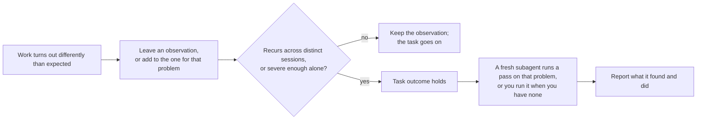

# Running a pass

A pass is this skill's instructions, read in a fresh context by an agent that gathers its own evidence. The user can start one the way their harness starts any task: in an interactive session they ask for a healing pass in their own words, and in the harness's non-interactive mode the launch message asks, for example "Use the self-healing skill to run a healing pass over the last week of my agent sessions." Any limit on what the pass may change or land goes in that request.

An agent starts one itself when an observation meets the bar for a finding, once its task's outcome holds:

Its brief names the problem and the observation file, the repositories and sessions in scope, and the mandate of the task that started it, which bounds what the pass may change and land. The pass reports its findings and end states back to the agent that started it, which includes them in its reply.

## Scheduling a pass

Set this up only when the user asks for a recurring pass.

Use the harness's own scheduling feature where it has a fitting one, or the operating system's scheduler (cron or a systemd user timer, `launchd`, Task Scheduler), to start the harness's non-interactive mode with the launch message on the chosen schedule. The scheduled session needs the permissions the pass itself needs, such as reading the repositories in scope, running their checks, and writing files, and the working directory an interactive pass would have; a scheduler that starts it with less silently limits what the pass can do. A scheduled pass lands its changes as SKILL.md's "Authority and delivery" says.
