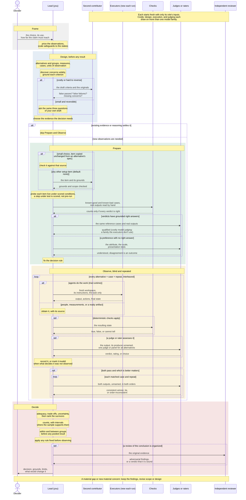

# Split Testing

You SHALL deliver the decision the comparison serves: which alternative to use, a conditional choice, a supported tie, a rejection of every alternative, or a statement that no evidence you can obtain decides it. A testing plan is the deliverable only when the user asks for one.

Scale the comparison to the stakes and to what it costs: price the observations it needs (people's time, materials, executor runs, judge calls) before collecting them. The plan's size follows the decision's: a small, reversible choice gets a short plan its owner can carry out in the time the choice is worth, and every safeguard below applies in proportion to what a wrong choice would cost. When later observations can change the decision only under some results of earlier ones, gather the cheapest decisive part first and fix in advance which results buy the rest. A choice you can settle from existing evidence or domain knowledge needs no new observations. A testable claim that others will rely on, or that changes standing instructions, needs observed results; a decision no observation can settle needs its criteria, grounds, assumptions, trade-offs, and limits stated instead.

Anything that can be chosen between is an alternative, including a direction that holds alternatives of its own, and your observations may come from any source: runs of the trial runtime, people's ratings and choices, analytics, measurements, and evidence that already exists. Compare a decision nothing can measure by its reasons against stated criteria. Before observing, fix what you observe each alternative on, which way is better on each measure (or that neither is), the units, and the cases the claim will cover. Record each observation with its alternative, measure, case, and the unit it came from (a repeat, rater, session, or person), and record totals as totals where only totals exist. Compare nested alternatives within each group and between groups, and read a pooled result after the parts it pools. Where criteria must be traded off, the weights are the decider's own: show them and the arithmetic, or each criterion unweighted.

Who does what, stage by stage, from the decision to the answer; a choice that existing evidence or reasoned comparison settles skips new observation and setup, never the assessment of whether that basis supports this decision:

When you observe, the comparison SHALL hold these properties:

- **Grounded criteria, fixed before results.** Acceptance conditions, success measures, and the direction of better come from what the consumer must accomplish, each with its grounds: the decider's purpose, an obligation, a practice that competent work in the field implies, observed failures, or a stated inference. They are fixed before you inspect outcomes; later amendments stay visible. Adequacy, preference, and excellence are separate judgments: alternatives first pass acceptance and only survivors are ranked, because every alternative can be inadequate, and beating the alternatives present shows excellence only against a high bar grounded on its own.
- **Challenged coverage.** Discovery of what could matter goes wide, and what you consider but do not measure stays visible, grouped by the reason it was set aside; an in-scope concern with no route to evidence stays unassessed, not irrelevant, and limits the claim. Before any result, a newly built evaluation faces three questions: could a result pass and still fail the intended use, could a good result fail for an irrelevant reason, and what consequential concern is missing. When a wrong choice would be costly or hard to reverse, a contributor other than its author asks them from the originals; otherwise its author asks them of the draft. Each supported concern gets a disposition; an unresolved one limits the claim.
- **Blind, isolated contributors.** Each separately assigned worker, candidate, rater, judge, and reviewer starts in a fresh context and receives only its own assignment and the originals its role needs, never another contributor's work its role does not need, the expected winner, or your hypothesis: a criteria author drafts from the request, the domain, and what the alternatives are, without candidate results, earlier scores, or the expected winner, a challenger sees the criteria it challenges, and a judge sees the output without its producer. Where a wrong choice would be costly, draw contributors from more than one model family, separately for designing the evaluation, executing, and judging; several contributors from one family are not that diversity. Isolation comes from the runtime and the environment, not from asking a participant to ignore what it can see.
- **Repeated observation.** Where behavior varies, you observe each alternative on each case enough times to tell its result from luck, in an interleaved order. Report counts with intervals where the sample supports them, and as plain counts where it does not; a handful of clean runs bounds a failure rate only loosely. Runs go where outcomes vary: a case every alternative passes, or every one fails, shows no difference on that pass measure, though it can still separate them on cost, time, or quality. Before a large run, estimate from earlier or pilot results whether its size can detect the difference worth acting on.
- **Qualified instruments.** A check, judge, or metric definition counts only after it gives the right verdict on known-good and known-bad cases, including a polished failure and a sound unconventional success where those exist, whose verdicts rest on grounds other than the instrument author's say-so, and on a sample of real outputs read by hand, since an instrument that passes reference cases can still misjudge what executors actually produce. Where a preference has no correct answer, qualification instead shows that raters understand the attribute and the scale and that presentation does not sway them; disagreement among them is an outcome. Deterministic checks on the resulting state come before model judgment. A judge sees no labels that reveal which alternative produced a response, the same judge or panel scores every alternative it compares, and where a wrong choice would be costly and model judges are used, a judge from a different model family than the executors counters self-preference.
- **Real conditions.** Cases reproduce the conditions that produce the behavior in question, including ordinary successes as well as failures. A requirement a case checks appears in what the executor was given, or follows from competent practice the request implies and is recorded with its grounds; hidden test cases are fine, hidden requirements are not.
- **Verified conditions.** Each alternative runs under the conditions the claim is about, with what is common to every workspace, what belongs to one alternative, and what is itself under test stated. Setup defaults to none. For a small, reversible choice, the author may check an item copied unchanged from the alternative's own specification, such as a recipe's oven temperature, against that source; every other item enters only when a contributor other than its proposer has checked its cited grounds and scope. Each item is probed live under the scored conditions (the hook fires, the equipment works) without leaking into the scored starting state or forcing behavior the comparison measures. A necessary item that cannot pass blocks the comparison or narrows its claim. When installing, discovering, or activating an alternative is itself under test, keep the specified starting state and score that step's success, failure, and cost instead of requiring it to succeed first.
- **Traceable conclusions.** Every decisive claim traces to a retained native record, including whether each executor actually read or loaded the material that differs between alternatives, so an unread treatment is not mistaken for one that failed. Each decisive claim says what was observed, judged, or simulated: simulated behavior supports claims about the simulation, and transfer to people or deployment needs grounds of its own. Summaries help navigation and never replace the records they summarize.

Choose the route by the observation the decision needs: existing evidence, reasoned assessment, measurement, people's ratings or choices, or what agents do and deliver. A tasting, a client panel, or published reviews are collected directly under the properties above, whoever produced the alternatives. When the observation is what agents do, or a blind judge's assessment of what they deliver (a business plan, a written recipe, a design, a pitch), alone or head-to-head, use the [trial runtime](references/trials.md): you write the plan and scenarios for the question, and the runtime supplies isolation, confinement, repetition, journaling, blind judging (including blind pairwise judging), and intervals. It starts each executor through a [launcher](references/launching.md) you write for whatever agent command line you can run here, and holds that launcher to its contract; where you can run none, use its [host executor](references/trials.md#host-executor): you start each executor by the host's own means, such as its subagents, relaying the run's files to any that cannot reach them, and the runtime does the rest. Where the host cannot run Python at all, carry out the same [trial flow](references/trial-flow.md) with the host's own means and with the bundled scripts that still run; the properties above hold either way. Gather observations the runtime cannot produce under the same properties, each with its source. Use [designing comparisons](references/designing-comparisons.md) when criteria and their challenge, workspace setup, allocation, analysis, judges, raters, nested alternatives, totals-only data, unmeasured decisions, or causal claims need more thought, and [workspaces](references/workspaces.md) when blind contributors share input copies outside the runtime.

When revising an alternative keeps moving its failure instead of removing it, question its premise and the comparison's frame before revising it again: an alternative revised against the same cases until it passes has been fitted to them, not shown sound.

When you organize a review of the conclusion, it SHALL include an independent adversarial contribution that works from the original evidence; a verdict that the work is sound is a valid result.

Your answer SHALL lead with the decision, then its grounds, its consequential limits, and what would change it. A standalone report is optional; when one serves the reader, it tells the whole story to someone who has never heard of the work: the background, what the decider set out to learn, every alternative in plain words, why each test exists, how to read each visual, and what its data says. [Presenting evidence](references/presenting-evidence.md) describes the bundled visual library for trials and for any other comparison.
