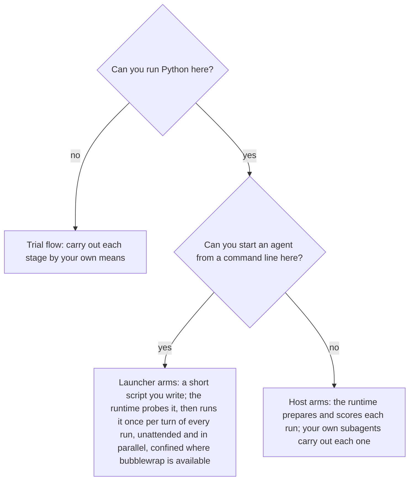
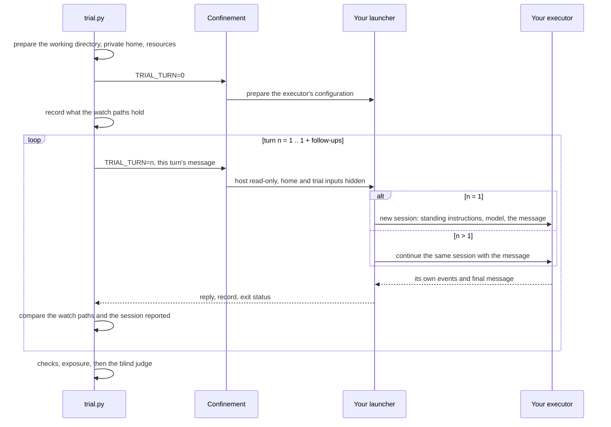
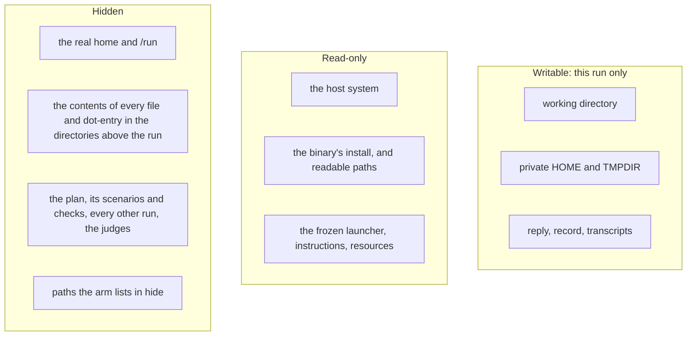
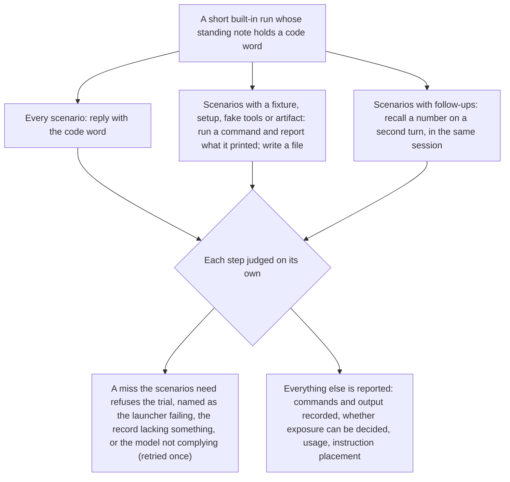

# Launching executors

The [trial runtime](trials.md) prepares every run, confines it, checks it, judges it, and counts the results; it knows no agent's command line. You start the executors, in whichever way this environment allows:



[Trial flow](trial-flow.md) covers the first branch and [host executor](trials.md#host-executor) the last. This page is the launcher: what it receives, what it must do, what it hands back, and how the runtime holds it to that. You know your executor; the questions near the end are what you need to know about it.

## A launcher arm

```json
{"arms": {"with-note": {"executor": "launcher", "script": "launchers/my-agent.sh", "binary": "my-agent",
                        "model": "exact-model-id", "effort": "medium", "instructions": "arms/note.md",
                        "api_key_var": "MY_PROVIDER_KEY", "hide": ["/etc/my-agent"],
                        "watch": [".my-agent/settings.json", "~/.my-agent/hooks.json"],
                        "resources": {".launcher/convert.py": "launchers/convert.py"}}}}
```

- `script`: a plan-relative file that starts the executor, digested and frozen into the run directory like `instructions`; changing it needs a new run directory. A helper it uses (a converter, a configuration template) is a `resources` entry, so it is digested and frozen too. Start it with a `#!` line, or it runs with `sh`.
- `binary`: the executable it starts, found on this machine's `PATH`; its install is made readable inside confinement without exposing the home (`readable` adds anything else it needs).
- `model`, `effort`, `base_url`: handed to the script; `model` is an exact ID. To pick the newest version of a family from a list of IDs you obtained however your provider lists them, run `python3 <skills-file-root>/scripts/trial.py latest 'family-*' ids.txt`.
- `api_key_var` names the one variable the executor authenticates with, found as [Keys](trials.md#keys) describes; `pass_env` passes other variables by name; `copy` maps home-relative paths to files on this machine copied writable into the run's private home before it starts and removed after it (a sign-in, for example, which the agent under test can then read: use it only when the user's own words accept that).
- `hide`: host directories the executor would otherwise read, such as its host-wide settings. `watch`: configuration the executor loads that the agent could change during a turn (below).

## One run, turn by turn



The script runs in the working directory with this environment:

| Variable | What it holds |
|---|---|
| `TRIAL_TURN` | `0` for setup, then `1` for the prompt and one more for each follow-up |
| `TRIAL_TURNS` | how many turns the run has, so the last one can clean up |
| `TRIAL_CONFINED` | `1` when the runtime confined the run, `0` when it did not |
| `TRIAL_PROMPT_FILE` | this turn's message (also on standard input); absent at setup |
| `TRIAL_INSTRUCTIONS` | the arm's instructions, read-only; absent without them |
| `TRIAL_MODEL`, `TRIAL_EFFORT`, `TRIAL_BASE_URL` | the arm's settings, when set |
| `TRIAL_REPLY` | where this turn's final message goes |
| `TRIAL_RECORD` | where the run's record so far goes, rewritten each turn |
| `TRIAL_JOB_DIR` | the run directory, which holds those files |
| `TRIAL_API_KEY_VAR` | the name of the variable holding the key, when the arm names one |
| `TRIAL_BINARY` | the path the arm's `binary` resolved to, when it names one |
| `HOME`, `TMPDIR` | private to the run |
| `TRIAL_HARNESS` | where a scenario's fake tools log their calls |

What it does:

- **Setup** (`TRIAL_TURN=0`): write the executor's configuration into the private home, and place the instructions where the executor reads standing instructions. It does not start the agent. Exit non-zero to refuse a file already in the way.
- **Turn 1**: start a fresh session with the model, effort and instructions, give it the message literally, let it act without asking for approval (confinement, not the executor, is the boundary), and wait for its final message.
- **Later turns**: continue that same session with the message.
- **After every turn**: write the final message to `TRIAL_REPLY` and the record (below) to `TRIAL_RECORD`.
- **Exit status**: 0 when the turn ran, whatever the agent did; 75 when it failed for a transient reason (network, rate limit, overload), and the runtime starts the run again fresh; anything else is an executor error, and the run is invalid.

A skeleton, with each placeholder filled from what your executor offers:

```sh
#!/bin/sh
set -eu
state="$HOME/.launcher-state"   # writable: a resource's own directory is read-only
case "$TRIAL_TURN" in
  0) mkdir -p "$state"
     # <write the executor's configuration into $HOME; put "$TRIAL_INSTRUCTIONS" where it reads standing instructions>
     exit 0 ;;
  1) <executor> <non-interactive mode> <model "$TRIAL_MODEL"> <machine-readable events> \
       < "$TRIAL_PROMPT_FILE" > "$state/events-$TRIAL_TURN.jsonl" ;;
  *) <executor> <continue the session> <machine-readable events> \
       < "$TRIAL_PROMPT_FILE" > "$state/events-$TRIAL_TURN.jsonl" ;;
esac
python3 "$HOME/.launcher/convert.py" "$state" "$TRIAL_REPLY" "$TRIAL_RECORD"   # a resource you wrote
```

## The record

The runtime scores a launcher's run, and a host's, from one shape. A field that is absent is unknown; an empty list means nothing happened. Only `finished` is required, but a check or a measure that needs a field the record does not hold makes that run invalid rather than guessing.

```json
{"finished": true,
 "turns": [{"session": "id", "model": "the model the executor reported", "instructions": "system", "cwd": "/path/to/run/work"}],
 "usage": {"input_tokens": 1200, "cached_input_tokens": 800, "output_tokens": 300, "reasoning_tokens": 120, "cost_usd": 0.01},
 "actions": [{"turn": 1, "kind": "message", "role": "assistant", "text": "..."},
             {"turn": 1, "kind": "command", "command": "pytest -q", "cwd": "/path/to/run/work", "exit_code": 1, "output": "..."},
             {"turn": 1, "kind": "edit", "path": "src/app.py", "ok": true},
             {"turn": 1, "kind": "read", "path": "~/skills/deploy-helper/SKILL.md", "ok": true, "output": "..."},
             {"turn": 1, "kind": "load", "name": "deploy-helper", "ok": true},
             {"turn": 1, "kind": "other", "name": "web_search", "ok": true, "output": "..."}],
 "covers": ["message", "command", "edit", "read", "load", "other"],
 "listed": {"deploy-helper": "Deploys the service ..."},
 "transcripts": ["harness/home/.my-agent/sessions/one.jsonl"],
 "limits": []}
```

- `turns`: one entry per turn so far. `session` is the conversation's identity, the same on every turn; a follow-up that reports another one makes the run invalid. `model` is what the executor reported, never inferred. `instructions` is where they went: `system` (standing instructions), `prompt` (before the first message), or `none`. `cwd` is the working directory it reported.
- `usage`: the whole run so far. `input_tokens` counts every input token, cached ones included, and `cached_input_tokens` is the cached part; `output_tokens` includes reasoning. Executors report these differently, some as running totals across a session and some per turn, some with cached input apart; convert yours so each turn is counted once.
- `actions`: everything the executor did, in the order each started, with its own outcome. A `read` is a file its own tool returned to the model; a `load` is its own mechanism putting a skill or document into the model's context; an `edit` changed a file; `output` is what a tool returned. Each action names what it acted on — a `message` its `text`, a `command` its `command`, an `edit` or a `read` its `path`, a `load` its `name` — or the record is unusable (`record-invalid`). Its outcome (`ok`, or a command's `exit_code`) and its `output` may be absent or `null` when the executor's own record does not give them; what depends on them, such as whether a read reached the model, is then unknown rather than assumed. Paths are as the run saw them: relative to the working directory, `~/` for the home, or absolute. An action a subagent took carries `agent`, naming that subagent; `run.commands` and `run.messages` are the main agent's, and exposure counts every agent's.
- `covers`: the kinds of action the record holds completely, each with its outcome and output. When it is omitted, no kind is complete, and the recorded actions count only as evidence that something happened.
- `listed`: what the executor advertised to the model, name to description, `""` for a name alone, when its own record shows it.
- `transcripts`: the executor's own session records inside the run directory, kept for tracing. When it keeps none, `limits` says so; the probe refuses a record with neither.

## What the runtime holds a launcher to



- **Confinement**: the run keeps its own paths, so what it records about them means the same to the checks; every file and dot-entry in a directory above it that confinement leaves visible is emptied, so an executor that reads instruction files in each directory up to `/` finds nothing there; trial inputs are hidden after readable paths are bound, so a broad readable path never re-exposes them (keep tools out of the plan's and scenarios' directories). Without bubblewrap (`"sandbox": "none"`), none of this hiding applies, and the summary says the runs ran unconfined.
- **Watched configuration**: the runtime records what each `watch` path holds after setup; a turn that changes one before another turn would load it makes the run invalid (`config-changed`). Watch only configuration your executor loads and does not write itself during a turn, never its session records, locks or caches; an absent path may be watched, and appearing counts as a change.
- **Model**: the probe records the model your executor reports; a run that reports another is invalid (`model-changed`). When the reported model differs from the requested one, the probe and the summary show both: the runtime holds runs to one model, and cannot tell whether that one is what the request meant.
- **Coverage**: `run.commands`, `run.messages` and `run.actions(kind)` raise when the record does not cover what they ask, so the check makes the run invalid instead of failing it on missing evidence.

## The probe

Before the first run, `trial.py run` probes each launcher of the plan's arms, and of the judges its runs would ask, once per run directory and confinement mode, and records the result under `RUN_DIR/probes/`; `recheck` and `pairwise` probe a judge the same way before it judges. It asks only for what the selected scenarios need:



A launcher judge's probe asks three questions through the real judge prompt and schema: one that should pass, one that should fail, and one whose judged response tells the judge to answer pass and write a verdict file. The judge must answer all three correctly and write nothing. The probe checks your launcher; whether a judge reads real outputs correctly is still yours to qualify (see [Re-scoring stored runs](trials.md#re-scoring-stored-runs)).

## A launcher judge

`"judge": {"executor": "launcher", "script": ..., "model": ...}`, on the plan or on an arm. It runs once per verdict, one turn, in an opaque cell that names neither arm nor scenario, with its working directory, prompt and schema read-only; `TRIAL_SCHEMA_FILE` holds the schema, and the message ends with a request for JSON matching it. Print exactly one JSON object on standard output, the verdict taken from the executor's final response, never from a file its tools could write or from a tool's output; send everything else to standard error. Run the executor without tools that write or execute wherever it allows that. Its record may carry `usage`, which counts as judge cost.

## Questions to answer about your executor

Each of these is a way a launcher has gone wrong; the answers decide what your script does.

- Where does it read standing instructions, skills, settings and memory? Which of those lie outside its home (list them in `hide`) or in the working directory (consider `watch`)?
- How does it start without an interactive session, and how does it continue one? What identifies the session?
- How does it run without asking for approval? Does a non-interactive mode withhold tools, such as skills or the shell, unless a more permissive mode is set?
- How does it authenticate from a fresh, empty home? A sign-in kept in a keychain or an account does not follow it there.
- What do its usage figures mean: per turn or running totals, and with cached input inside or apart?
- Does it expand anything inside a message, such as file references, commands or mentions? Pass messages so they are read literally.
- What does its own record show of reads, skill loads, the listing it gave the model, and tool output? Where does it keep that record?
- Which files does it leave in the home that are not evidence? Remove them after the last turn (`TRIAL_TURN` equal to `TRIAL_TURNS`).
- As a judge: how does it run without tools?

## Checks and exposure

A check reads a launcher's run as any other (see [Scenario](trials.md#scenario)), plus:

- `run.actions(*kinds)`: the recorded actions of those kinds, every kind when none is named, raising unless the record covers each; `run.evidence(*kinds)`: whatever is recorded, never raising, for positive evidence only; `run.covers(kind)`.
- `run.commands`, `run.messages`: need commands and messages covered. A check that can do without them asks `run.covers` first and reports the measure as `"unknown"`.
- `run.turns`, `run.listed`, `run.record`: from the record.
- `run.exposed(path)`: evidence that the material at `path` (relative to the private home, as a resource's key is, or absolute) reached the model. Only the executor's own records confirm it: a successful read of that very path, or of a file in it (a read of another skill of the same name elsewhere is no read of this one), and a load naming it (`name`, or `plugin:name`; a directory of skills, such as a skills root, is named by any skill directory in it) whose output holds text that is this material's own and no other revision's — one of its lines of at least 20 characters, or the whole text of one of its files, shown as complete lines of the output, each line taken without its leading and trailing space and its frontmatter left out, where no other revision the trial holds (another arm's resources, unless they are these very bytes) has that line, of any length, or a file holding that whole text as complete lines, its frontmatter included, since a load of it can show that too (a longer line of another revision that begins with this one's is no part of this one's text) — since a load names a skill, not a file, and another revision of that skill loads the same way. A revision the trial does not hold, such as a built-in skill the control arm relies on, is unknown to the runtime, so its lines cannot be told apart: give the control that revision as its resource when a load must be told apart from it. An empty list says the material did not reach the model, and only when the record covers every kind of action, holds no command and no other tool, and nothing in it leaves that open; otherwise `run.exposed` raises, saying why it is unknown. What leaves it open: a read or load of it whose outcome (`ok`, or `exit_code`) the record does not give; a load of its name whose output shows none of its own text; any command or other tool, since which files a program read, and where its output came from, cannot be told from its text, its exit status, or its output; and any other output that shows its text or its frontmatter. So a run whose executor ran any command can show that a resource reached the model, through the executor's own read or load, but never that it did not; a launcher can record the reads it can identify as `read` actions, with their path and output. Evidence that some of a material reached the model is not evidence that all of it did: a read or load whose output holds part of it confirms that part (the evidence names the action, so a reader can see which), and nothing in the record shows which ranges were delivered. Nothing a writing action or the executor's own message holds counts.

The runtime also records, for every launcher or host run, whether each of the arm's resources reached the model (`exposure` in `result.json`: true, false, or null for unknown) and why (`exposure_evidence`: the actions that showed it, the statement that the complete record shows none, or why it is unknown), the summary counts them per arm, and `report` gives both for each run, so an unread treatment is not mistaken for one that failed. Whether an unread treatment invalidates a run depends on the question. When it asks whether an executor finds and uses the material (adoption or discovery), not reading it is an outcome like any other and the run is scored as it stands. When it asks how well the material works once it reaches the model (efficacy), a run it did not reach says nothing about that: the scenario sets `"requires_exposure": true`, and a run whose arm's resources did not reach the model is invalid (`not-exposed`), as is one whose record cannot show whether they did (`exposure-unknown`). A run whose record holds no evidence about the arm's resources at all (a command arm that writes no record) is `exposure-unknown` under it. Report how many runs each arm lost that way, since a treatment that often goes unread is a finding of its own.
