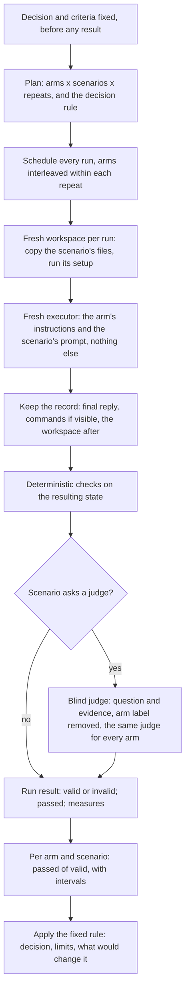
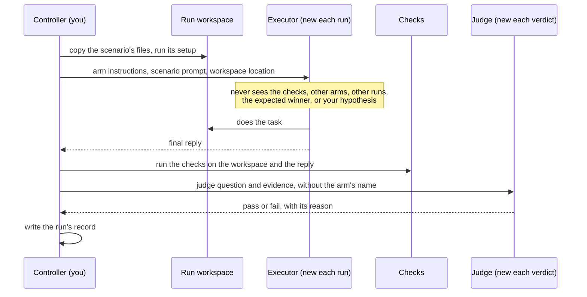

# Trial flow

[`scripts/trial.py`](trials.md) carries out this flow when it can start the executors itself, through a [launcher](launching.md) you write for an agent's command line, or a shell command. On a host that can run Python but starts its executors by its own means, such as its subagents or an app's agent feature, the runtime's [host executor](trials.md#host-executor) carries it out too: the runtime prepares, checks, judges, and records every run, and you start each executor and hand back its reply, relaying the run's files to and from an executor that cannot reach them. Where the host cannot run Python at all, you carry out the same flow with the host's own means, as below. Each stage's guarantee is what makes the result a trial; the tool that provides it is interchangeable.

Who sees what in one run:

## Each stage without the runtime

- **Workspace.** Give every run its own fresh copy of the scenario's files, made before the executor starts, outside any repository whose instruction files the executor would load, and holding nothing from another run. [`scripts/prepare_workspaces.py`](workspaces.md) makes such copies and needs only Python. Run the scenario's setup inside the copy.
- **Executor.** Start a new executor for every run, with no inherited conversation, memory, or other instructions. Give it the arm's instruction text as its standing instructions where the host allows that, or otherwise verbatim before the prompt in every arm alike. Give it the scenario's prompt unchanged and the location of its workspace. Keep the checks, the other arms' texts, and other runs' workspaces where it cannot read them if the host can enforce that. Record in the results whatever isolation you could not enforce.
- **Order.** Run every arm on every scenario the same number of times, and interleave the arms within each repeat rather than running one arm's runs in a block.
- **Record.** Keep each run's final reply, the commands it ran when the host shows them, and its workspace as it was left. Every claim in the conclusion traces back to these records.
- **Checks.** Run the checks after the executor finishes, on the workspace and the reply. Never show them to the executor. Where a scenario's `check.py` expects the runtime's `run` object and the runtime is absent, read what each check asserts and apply the same assertions to the workspace yourself.
- **Judge.** Use a new judge for each verdict, give it the scenario's question and the evidence with the arm's name removed, and have the same judge, or the same panel, score every arm the comparison compares, preferring a model family none of the arms uses. Give it what it judges in a form it can read; when it cannot read the output (an image to a text-only judge), it does not judge that run.
- **Validity.** A run is failed when something that decides it was observed to fail: a required check is false, the deliverable it was asked for is missing, or the judge says fail. It is invalid, neither passed nor failed, when what would decide it was not observed: its executor did not finish (unless the scenario fixed beforehand that not finishing fails), its checks or judge could not run, a required check could not tell, the judge could not read the output, or the judge said the evidence cannot decide (unless the scenario fixed beforehand that a judgment it cannot make fails). Before reading results, run again only a run whose executor did not finish; a run whose executor finished keeps its output, which you score again once the check or judge can decide it (a fixed check, a judge that answers), since replacing an output that was hard to score with a new one would resample exactly those runs. Report any that stay invalid, and how many each alternative lost.
- **Aggregate.** For each arm and scenario, count passed of valid runs and give an interval: the 95% Wilson interval for k passes in n runs is (p + z²/2n ± z·√(p(1−p)/n + z²/4n²)) / (1 + z²/n), with p = k/n and z = 1.96. Then apply the rule you fixed before any results.

If Python is available, write each run's record as `runs/<scenario>__<arm>__r<repeat>/result.json` in a directory that also holds a `plan.json` naming the arms and scenarios, `{"arms": ["<arm>", ...], "scenarios": ["<scenario>", ...]}` (a scenario may instead be an object with its `"name"`, as below). Each record is `{"job": "<that directory name>", "arm": ..., "scenario": ..., "repeat": n, "status": ..., "passed": ..., "checks": {...}}`, with `status` and `passed` as the run went:

| The run | `status` | `passed` |
|---|---|---|
| passed | `"ok"` | `true` |
| observed to fail | `"ok"` | `false` |
| invalid, its executor finished (a check or the judge could not decide it) | `"ok"` | `null` |
| invalid, its executor did not finish | what happened, such as `"timeout"` or `"unfinished"` | `null` |
| did not finish, under a scenario that fixed beforehand that not finishing fails | `"timeout"` or `"unfinished"` | `false` |

The last row counts only when that scenario's entry in `plan.json` says so beforehand, as `{"name": "<scenario>", "timeout_fails": true}`. Then `python3 scripts/trial.py summarize DIR` gives the counts and intervals; that step needs no executor CLI. A record that breaks this contract (a `passed` that is not `true`, `false`, or `null`; one that is not `null` for a status other than `"ok"`, outside that exception; a `job` other than its directory's name; a missing `arm`, `scenario`, or `status`; a `repeat` that is not a whole number from 1) is left out of every count, and `summarize` says how many it left out and why the first was.
